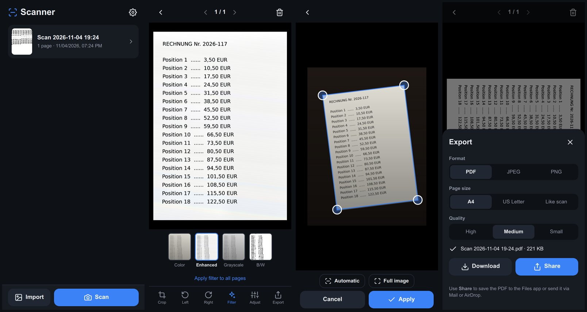

# 📄 Scanner – Dokumenten-Scanner als PWA

[English](README.md) · **Deutsch**

Eine Progressive Web App zum Scannen von Dokumenten mit dem Smartphone, ähnlich wie bekannte Cam-Scanner-Apps.
Sie läuft komplett im Browser und funktioniert offline. Alle Daten bleiben auf dem Gerät: Es gibt keinen Server, kein Tracking und keine externen Bibliotheken.

### 👉 Zur App: **[laserrapt0r.github.io/document-scanner-pwa](https://laserrapt0r.github.io/document-scanner-pwa/)**



## Funktionen

- **Aufnehmen**
  - In-App-Kamera mit Serienaufnahme (mehrere Seiten hintereinander) und Taschenlampe, sofern das Gerät sie unterstützt
  - Alternativ die native iOS-Kamera (einstellbar)
  - Import von Bildern aus der Mediathek, auch mehrere auf einmal
- **Live-Rahmen** um das erkannte Dokument im Kamerabild
- **Automatische Randerkennung**, robust auch bei schlechtem Licht (Rauschminderung, Konturanalyse, Kantenanpassung)
- **Perspektivkorrektur mit echtem Seitenverhältnis**, damit Seiten nicht gestaucht oder gestreckt werden
- **Automatisches Licht** bei Dunkelheit, sofern das Gerät es unterstützt, sonst ein Hinweis
- **Rahmenprüfung nach jedem Foto:** erkannten Rahmen anpassen oder Foto neu aufnehmen
- **Manuelles Zuschneiden:** Ecken oder ganze Kanten ziehen oder einen neuen Rahmen aufziehen; eine Lupe hilft beim präzisen Setzen
- **Filter:** Farbe (Original), Verbessert (gleicht Schatten aus, Papier wird weiß), Graustufen, Schwarz/Weiß; mit Rauschminderung bei wenig Licht
- **Helligkeit und Kontrast**, auf Wunsch für alle Seiten auf einmal
- **Drehen** nach links und rechts
- **Mehrseitige Dokumente:** Seiten hinzufügen, sortieren und löschen, zwischen Seiten wischen
- **Dokumentbibliothek:** Umbenennen, Duplizieren, Löschen; Speicherung in IndexedDB
- **Export**
  - PDF mit mehreren Seiten (A4, US Letter oder „Wie Scan“), JPEG oder PNG
  - Drei Qualitätsstufen mit Anzeige der Dateigröße
  - Alle Seiten oder nur die aktuelle Seite
  - **Teilen** über das Teilen-Menü: In Dateien sichern, Mail, AirDrop oder **Bild sichern** (bei JPEG/PNG landet das Bild in der Fotos-App)
  - **Herunterladen**; mehrere Bilder werden automatisch als ZIP gepackt
- **Installationshinweis:** Beim Öffnen im Browser erklärt ein Banner, wie man die App auf den Home-Bildschirm legt (iOS). Unter Android/Chrome gibt es einen echten Installieren-Knopf.
- **Sprachen:** Deutsch, Englisch, Französisch und Spanisch. Die App folgt der Gerätesprache, in den Einstellungen lässt sich die Sprache auch von Hand wählen.

## Auf dem iPhone installieren

1. **[laserrapt0r.github.io/document-scanner-pwa](https://laserrapt0r.github.io/document-scanner-pwa/)** in **Safari** öffnen.
2. Auf **Teilen** (Quadrat mit Pfeil) und dann auf **Zum Home-Bildschirm** tippen.
3. Die App startet danach vom Home-Bildschirm im Vollbild und funktioniert auch offline.

Unter Android den Link in Chrome öffnen und im Menü **App installieren** wählen.

Hinweise:
- Beim ersten Öffnen der In-App-Kamera fragt iOS nach der Kamera-Berechtigung. Je nach iOS-Version kommt diese Frage bei jedem App-Start erneut.
- Die Scans liegen im Speicher der Home-Bildschirm-App. Wird die App vom Home-Bildschirm gelöscht, sind auch die Scans weg. Wichtige Dokumente daher exportieren.

## Selbst hosten / Entwicklung

Die App besteht aus statischen Dateien und braucht keinen Build-Schritt. Lokal starten:

```bash
python3 -m http.server 8080
# danach http://localhost:8080 öffnen
```

`localhost` gilt als sicherer Kontext, deshalb funktionieren dort Kamera und Service Worker. Zum Testen auf dem Handy im Netzwerk ist HTTPS nötig, z. B. über GitHub Pages.

**Auf GitHub Pages veröffentlichen:** unter *Settings → Pages* die Option *Deploy from a branch* wählen, dann Branch `main` und Ordner `/ (root)`. Alle Pfade sind relativ, die App läuft also in jedem Unterverzeichnis.

**Updates ausrollen:** nach Änderungen in `sw.js` die Konstante `VERSION` erhöhen (z. B. `v1.1.1`). Installierte Apps zeigen dann den Hinweis **Neue Version verfügbar → Aktualisieren**.

**Sprache hinzufügen:** in [`js/i18n.js`](js/i18n.js) einen Eintrag in `LANGUAGES` und ein Wörterbuch in `DICT` ergänzen. Fehlende Schlüssel fallen auf Englisch zurück.

## Aufbau

| Datei | Inhalt |
|---|---|
| `index.html` | Oberfläche (Ansichten, Dialoge) |
| `css/style.css` | Gestaltung |
| `js/app.js` | App-Logik, Navigation, Editor, Export |
| `js/i18n.js` | Übersetzungen und Spracherkennung |
| `js/imaging.js` | Bildverarbeitung: Perspektivkorrektur, Filter, Randerkennung |
| `js/pdf.js` | PDF-Erzeugung (ohne externe Bibliothek) |
| `js/zip.js` | ZIP-Erzeugung für den Mehrfach-Download |
| `js/camera.js` | Kamera-Zugriff (getUserMedia) |
| `js/db.js` | Speicherung in IndexedDB |
| `sw.js` | Service Worker für den Offline-Betrieb |
| `manifest.webmanifest`, `icons/` | PWA-Manifest und App-Icons |

## Datenschutz

Fotos und Dokumente verlassen das Gerät nie. Die App stellt keine Netzwerkanfragen außer zum Laden ihrer eigenen Dateien.

## Ideen

- Texterkennung (OCR) für durchsuchbare PDFs
- Unterschrift und Wasserzeichen
- PDF mit Passwortschutz
- Live-Randerkennung im Kamerabild mit automatischer Auslösung
