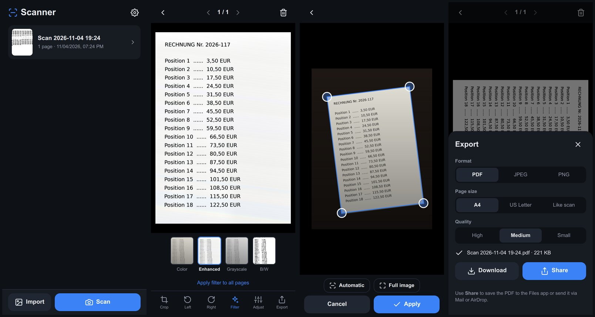

# 📄 Scanner – Document Scanner PWA

**English** · [Deutsch](README.de.md)

A Progressive Web App for scanning documents with your smartphone, similar to popular cam-scanner apps.
It runs entirely in the browser and works offline. All data stays on your device: there is no server, no tracking and there are no external libraries.

### 👉 Open the app: **[laserrapt0r.github.io/document-scanner-pwa](https://laserrapt0r.github.io/document-scanner-pwa/)**



## Features

- **Capture**
  - In-app camera with batch mode (several pages in a row) and torch, where the device supports one
  - Alternatively the native iOS camera (configurable)
  - Import images from the photo library, including several at once
- **Live document frame** in the camera view
- **Automatic edge detection**, robust in low light (denoising, contour analysis, line fitting)
- **Perspective correction with the true aspect ratio**, so pages are not squashed or stretched
- **Automatic torch** in low light, where the device supports it, otherwise a hint
- **Frame review after each photo:** adjust the detected frame, or retake the photo
- **Manual cropping:** drag corners or whole edges, or draw a new frame; a magnifying loupe helps with precise placement
- **Filters:** Color (original), Enhanced (removes shadows, paper turns white), Grayscale, Black & White; with noise reduction in low light
- **Brightness and contrast**, optionally applied to all pages at once
- **Rotate** left and right
- **Multi-page documents:** add, reorder and delete pages, swipe between pages
- **Document library:** rename, duplicate, delete; stored in IndexedDB
- **Export**
  - Multi-page PDF (A4, US Letter or "like scan"), JPEG or PNG
  - Three quality levels with file size preview
  - All pages or only the current page
  - **Share** via the system share sheet: save to Files, Mail, AirDrop or **Save Image** (for JPEG/PNG this puts the image in the Photos app)
  - **Download**; several images are bundled into a ZIP automatically
- **Install prompt:** when opened in the browser, a banner explains how to add the app to the home screen (iOS). On Android/Chrome it offers a real install button.
- **Languages:** English, German, French and Spanish. The app follows the device language, and you can switch manually in the settings.

## Install on iPhone

1. Open **[laserrapt0r.github.io/document-scanner-pwa](https://laserrapt0r.github.io/document-scanner-pwa/)** in **Safari**.
2. Tap **Share** (the square with an arrow), then **Add to Home Screen**.
3. The app now starts full-screen from the home screen and also works offline.

On Android, open the link in Chrome and choose **Install app** from the menu.

Notes:
- The first time you use the in-app camera, iOS asks for camera permission. Depending on the iOS version, it asks again on every app launch.
- Scans are stored in the home-screen app's storage. Removing the app from the home screen deletes them too, so export important documents.

## Self-hosting / development

The app is a set of static files with no build step. Run it locally with:

```bash
python3 -m http.server 8080
# then open http://localhost:8080
```

`localhost` counts as a secure context, so the camera and service worker work there. Testing on a phone over the network needs HTTPS, for example via GitHub Pages.

**Deploying on GitHub Pages:** go to *Settings → Pages* and choose *Deploy from a branch*, then branch `main` and folder `/ (root)`. All paths are relative, so the app works in any sub-directory.

**Releasing updates:** after changing files, increase `VERSION` in `sw.js` (e.g. `v1.1.1`). Installed apps then show a **New version available → Update** notice.

**Adding a language:** add an entry to `LANGUAGES` and a dictionary to `DICT` in [`js/i18n.js`](js/i18n.js). Missing keys fall back to English.

## Project structure

| File | Purpose |
|---|---|
| `index.html` | UI (views and dialogs) |
| `css/style.css` | Styling |
| `js/app.js` | App logic, navigation, editor, export |
| `js/i18n.js` | Translations and language detection |
| `js/imaging.js` | Image processing: perspective correction, filters, edge detection |
| `js/pdf.js` | PDF writer (no external library) |
| `js/zip.js` | ZIP writer for multi-image downloads |
| `js/camera.js` | Camera access (getUserMedia) |
| `js/db.js` | IndexedDB storage |
| `sw.js` | Service worker for offline use |
| `manifest.webmanifest`, `icons/` | PWA manifest and app icons |

## Privacy

Photos and documents never leave the device. The app makes no network requests apart from loading its own files.

## Ideas

- Text recognition (OCR) for searchable PDFs
- Signatures and watermarks
- Password-protected PDFs
- Live edge detection in the camera view with automatic capture
